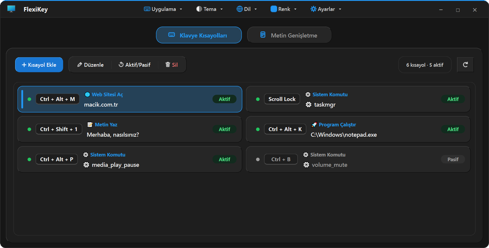
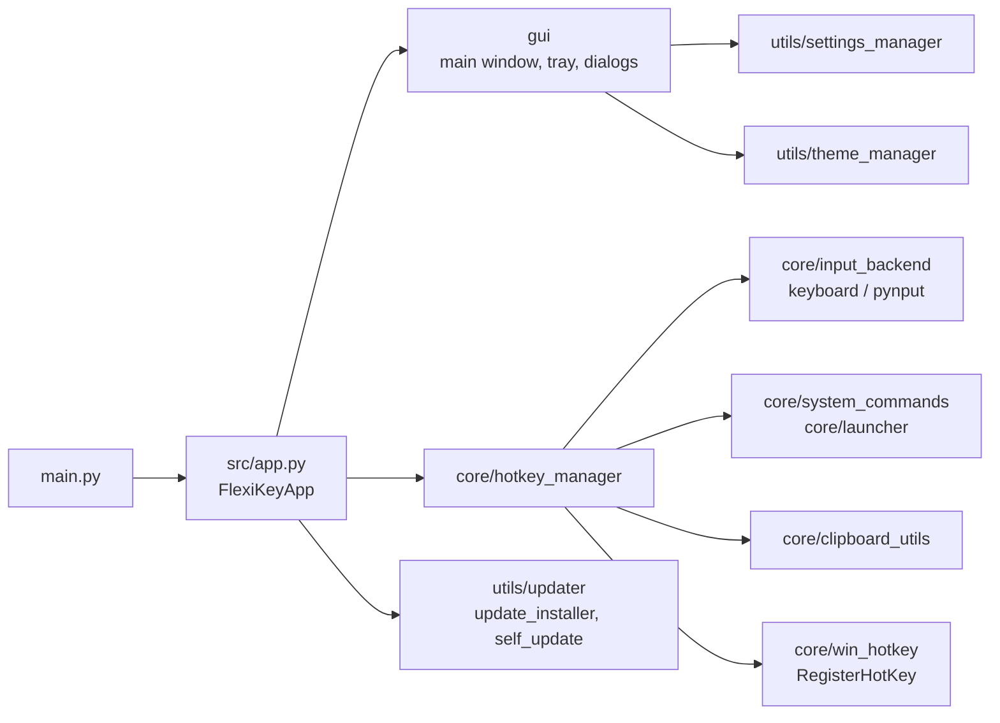

<div align="center">

# FlexiKey

**Bind key combinations to actions and expand short triggers into longer text, from the system tray.**


English | [Türkçe](README.tr.md)

<picture>
  <source media="(prefers-color-scheme: dark)" srcset="docs/images/flexikey-dark.webp">
  <source media="(prefers-color-scheme: light)" srcset="docs/images/flexikey-light.webp">
  
</picture>

</div>

FlexiKey is a Windows desktop app built with PyQt6. You record a key combination, pick what it should do, and the
shortcut works in every application. A second tab turns short triggers such as `@mail` into longer text, either plain or
formatted. The app lives in the system tray and can start with Windows.

## Highlights

- Six kinds of action per shortcut: open a website, open a file or folder, run a program, run a built-in system
  command, type a text, or send another key combination.
- Built-in system commands in ten groups (power, screen, apps, media, volume, windows and desktops, browsers, browser
  navigation, quick-access folders, text editing). Commands that cannot be undone ask for confirmation first.
- Text expansion for plain text and for rich (HTML) text, triggered by typing the trigger and pressing **Space**.
- Backup and transfer of shortcuts, expansions and settings, with a preview that flags risky actions before import.
- Light, dark or system theme, ten accent colors, Turkish and English interface.
- Settings are written atomically; a damaged settings file is set aside and the last good copy is restored.
- Self-updating executable: the download is checked against the SHA-256 checksum the server provides, and the old version
  is restored automatically if the new one fails to start.
- Windows is the primary platform. The macOS and Linux code paths exist and are unit tested, but they have never been
  run on real machines, so treat them as experimental.

## Features

### Shortcut actions

| Action | What it does |
|---|---|
| Open Website | Opens a URL in the default browser (`https://` is added when missing). |
| Open File/Folder | Opens a file or folder with its default application. |
| Run Program | Starts a program; the value can include arguments. |
| System Command | Runs one of the built-in commands, for example task manager, screenshot, volume, media keys, virtual desktops, window snapping, lock, sleep. |
| Type Text | Types a text into the focused window. |
| Send Keyboard Shortcut | Sends another key combination. |

Shut down, restart, sign out and empty recycle bin always show a confirmation dialog (the default button is **No**).
Imported shortcuts are previewed first, and destructive commands, program launches and custom command lines are flagged.

### Text expansion

| Kind | Behaviour |
|---|---|
| Plain | The trigger is erased and replaced by the text as soon as you type the trigger and press **Space**. |
| Rich (HTML) | Keeps formatting such as bold, italic, underline and color. The formatted text is pasted through the clipboard; your previous clipboard contents are restored afterwards. If pasting fails, plain text is typed instead. |

Pressing **Enter** never expands a trigger; it only ends the word. For rich triggers FlexiKey keeps a short buffer of the
typed characters. The buffer is only kept while rich triggers exist, it is discarded after five seconds without typing, and
it is not filled while a classic Windows password box has focus. Password fields drawn by browsers or by UWP, WPF and
Electron apps cannot be detected, so the timeout is the real safeguard.

### Application

| Area | Details |
|---|---|
| Shortcut list | Add, edit, delete, enable or disable single entries, refresh. Edit, Toggle and Delete stay disabled until an entry is selected, and a tooltip says what to do. |
| Tray | Closing the window sends the app to the tray. A single click on the tray icon opens the window; the context menu offers Show/Hide, Settings, Theme, Language, Quick Actions (disable all shortcuts temporarily, reload the configuration) and Exit. |
| Single instance | Starting a second copy raises the window of the first one. |
| Start at Login | Writes a value under `HKCU\...\Run` (with `--minimized` when Start Minimized is on). It is on by default in the first run of a built executable and can be turned off in Settings. |
| Notifications | Desktop notifications are optional (Settings, off by default) and use the system notification path. |
| Settings | Theme, accent color, language, Start Minimized to System Tray, Start at Login, desktop notifications, update options, Backup & Export. |

## Installation

**Official binary.** Download `FlexiKey.exe` from [macik.com.tr](https://macik.com.tr). It is a single file and needs no
installer. Put it in a folder you can write to (for example the Desktop) so that in-app updates can replace it.

**From source.** Requires Windows and Python 3.12 (the version the project is developed and tested with).

```powershell
git clone https://github.com/Aseloth99/flexikey.git
cd flexikey
py -3.12 -m pip install -r requirements.txt
py -3.12 main.py
```

Add `--minimized` to start in the tray. A window that runs as administrator only receives your shortcuts when FlexiKey
also runs as administrator. Updates cannot be installed automatically when running from source.

Where things are stored on Windows:

| What | Where |
|---|---|
| Settings | `%APPDATA%\FlexiKey\config.json` (the previous good copy is kept as `config.json.bak`) |
| Logs and crash log | `%LOCALAPPDATA%\FlexiKey\logs\` |
| Initial settings | A `config.json` next to the executable (or in the working directory) is read once, on the first start, when no user settings exist. |

## Usage

**Create a shortcut**

1. Click **Add Shortcut** (`Ctrl+N`).
2. Click the shortcut box and press the key combination you want, for example `Ctrl+Shift+M`.
3. Choose the action type and fill in its value.
4. Save. The shortcut is active immediately.

**Create a text expansion**

1. Open the **Text Expansion** tab and click **Add Expansion** (`Ctrl+Shift+N`).
2. Enter a trigger such as `@mail` or `/addr` and the text to insert (formatted text is supported).
3. In any application, type the trigger and press **Space**.

### Keyboard shortcuts of the app

| Keys | Action |
|---|---|
| `Ctrl+N` | New shortcut |
| `Ctrl+Shift+N` | New text expansion |
| `Ctrl+,` | Settings |
| `F1` | User guide |
| `Space` | Enable or disable the selected entry (while the list has focus) |
| `Ctrl+Q` | Quit the app (`Alt+F4` only closes the window; the app keeps running in the tray) |
| `Ctrl+Shift+V` | In the expansion editor: paste without formatting |

## Updates and announcements

FlexiKey checks `https://macik.com.tr/api/updates/check` once a day (turn it off in Settings, or press **Check for
Updates** there for an immediate check). When a newer version exists, an **Update · vX** pill appears in the title bar and at the top of the tray
menu. It opens a window with the version, the download size and the release notes.

- **Update Now** downloads the package, verifies its SHA-256 checksum, replaces the running executable and restarts the
  app (open if the window was open, in the tray otherwise). If the server sends no checksum, the download still proceeds
  and a warning is written to the log.
- The download address must use `https` and belong to `macik.com.tr` or one of its subdomains.
- The old executable is kept as `.old` until the new version has run successfully. If the new version fails to start twice,
  the old one is restored and that version is not offered again.
- With **Check for Updates Automatically** and **Install Updates Automatically** on (both are on by default), the app
  installs an update by itself while it is not in use. This only happens when the server supplies a valid checksum.
- An update that the server marks as mandatory is downloaded and installed in the background without asking.
- The application folder must be writable (a Desktop folder works; Program Files does not).

The server can also send an announcement. It appears as a single line at the top of the window as plain text, can be
dismissed with the close button, and is not shown again once dismissed.

## Architecture



```
flexikey/
├── main.py                    entry point
├── FlexiKey.spec              PyInstaller spec
├── build.bat                  builds dist\FlexiKey.exe and dist\FlexiKey.zip
├── file_version_info.txt      Windows version resource
├── requirements.txt           runtime dependencies
├── requirements-dev.txt       runtime + PyInstaller
├── assets/icons/              application icons
├── docs/images/               README screenshots
├── src/
│   ├── app.py                 FlexiKeyApp: single instance, managers, update flow
│   ├── core/                  input and actions (no Qt window code)
│   ├── gui/                   windows, tray, dialogs
│   └── utils/                 settings, theme, translations, updates, platform helpers
└── tests/                     unittest suite
```

| Module | Responsibility |
|---|---|
| `core/hotkey_manager.py` | Registers shortcuts and expansions, matches typed text, runs actions, asks for confirmation on destructive commands. |
| `core/input_backend.py` | Input abstraction: `keyboard` on Windows, `pynput` on macOS and Linux, a soft-failing backend elsewhere. |
| `core/win_hotkey.py`, `core/win_input.py` | Windows specifics: `RegisterHotKey` (used when the combination allows it, otherwise the low-level hook is used), password-box check, idle time. |
| `core/system_commands.py`, `core/launcher.py` | Command tables for Windows, macOS and Linux; launch planning without a shell on macOS and Linux. |
| `core/clipboard_utils.py` | CF_HTML clipboard format, safe clipboard access, snapshot and restore. |
| `core/action_policy.py` | Destructive command list, validation of command lines, import preview. |
| `gui/main_window.py` | Main window, shortcut and expansion editors, settings dialog, import and export. |
| `gui/tray_manager.py`, `gui/notice_bar.py`, `gui/update_dialog.py` | Tray icon and menu, announcement line, update window. |
| `gui/message_box.py`, `gui/chrome_dialog.py` | Frameless message boxes and dialogs that follow the theme. |
| `utils/settings_manager.py` | Atomic JSON settings, backup, quarantine of damaged files, schema checks. |
| `utils/updater.py`, `utils/update_installer.py`, `utils/self_update.py` | Update check, download with checksum, in-process replacement and rollback. |
| `utils/remote_notice.py` | Parses and validates the server announcement. |
| `utils/startup.py`, `utils/autostart_unix.py` | Start at login: registry on Windows, LaunchAgent or XDG autostart elsewhere. |
| `utils/theme_manager.py`, `utils/locales.py` | Themes and accent colors, Turkish and English strings. |

## Build

```powershell
build.bat
```

The script picks the first Python that has pip (`py -3.12`, `py -3.13`, `py -3`, `py`), installs `requirements-dev.txt`,
runs PyInstaller with `FlexiKey.spec`, and writes `dist\FlexiKey.exe` plus `dist\FlexiKey.zip` (the exe at the archive
root, which is the layout the updater accepts). Set `PYTHON` to use a specific interpreter. The manual equivalent:

```powershell
py -3.12 -m pip install -r requirements-dev.txt
py -3.12 -m PyInstaller FlexiKey.spec --clean --noconfirm
```

The version number lives in `UpdateChecker.CURRENT_VERSION` (`src/utils/updater.py`) and must match
`file_version_info.txt`; a test checks this.

## Tests

```powershell
py -3.12 -X utf8 -m unittest discover -s tests
```

The suite uses only the standard `unittest` module and runs Qt offscreen (`QT_QPA_PLATFORM=offscreen` is set by
`tests/_support.py`). One group of message box tests also starts a subprocess that shows a window far outside the
visible screen area.

## Notes

- FlexiKey uses PyQt6, which is available under GPL-3.0 or a commercial license. The source code of this repository is
  MIT licensed; when you distribute binaries built with PyQt6, the license terms of PyQt6 apply to them. The `pynput`
  dependency is LGPL-3.0.
- Windows is the primary platform. The macOS and Linux branches (input backend, command tables, autostart) are unit tested
  but have not been run on real macOS or Linux systems.

## License

[MIT](LICENSE) © 2026 Mustafa Açık
