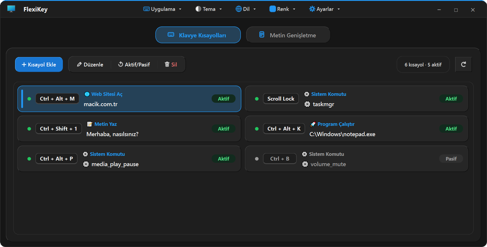
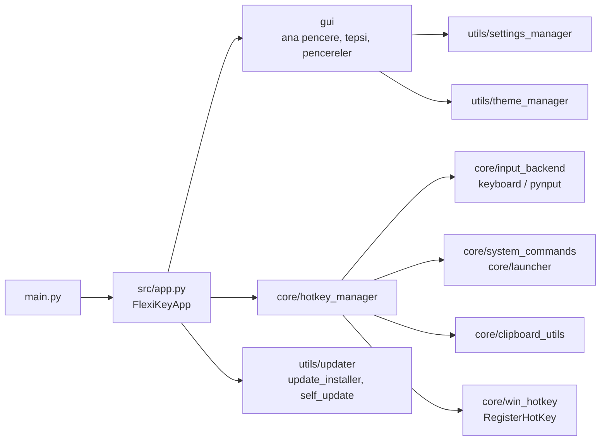

<div align="center">

# FlexiKey

**Tuş birleşimlerine eylem bağlayın, kısa tetikleyicileri uzun metne çevirin; hepsi sistem tepsisinden.**


[English](README.md) | Türkçe

<picture>
  <source media="(prefers-color-scheme: dark)" srcset="docs/images/flexikey-dark.webp">
  <source media="(prefers-color-scheme: light)" srcset="docs/images/flexikey-light.webp">
  
</picture>

</div>

FlexiKey, PyQt6 ile yazılmış bir Windows masaüstü programıdır. Bir tuş birleşimini tuşlara basarak kaydedersiniz, ne
yapacağını seçersiniz ve kısayol her uygulamada çalışır. İkinci sekme, `@mail` gibi kısa tetikleyicileri düz ya da biçimli
uzun metne çevirir. Program sistem tepsisinde yaşar ve Windows ile birlikte başlayabilir.

## Öne Çıkanlar

- Kısayol başına altı eylem türü: web sitesi aç, dosya ya da klasör aç, program çalıştır, hazır sistem komutu çalıştır,
  metin yaz ya da başka bir tuş birleşimi gönder.
- On grupta hazır sistem komutu (güç, ekran, uygulamalar, medya, ses, pencere ve masaüstü, tarayıcılar, tarayıcı
  gezintisi, hızlı erişim klasörleri, metin düzenleme). Geri alınamayan komutlar çalışmadan önce onay ister.
- Düz ve zengin (HTML) metin genişletme; tetikleyiciyi yazıp **Boşluk** tuşuna basmanız yeterlidir.
- Kısayolların, genişletmelerin ve ayarların yedeklenmesi ve aktarımı; içe aktarmadan önce riskli eylemleri işaretleyen
  önizleme.
- Açık, koyu ya da sistem teması, on vurgu rengi, Türkçe ve İngilizce arayüz.
- Ayarlar atomik olarak yazılır; bozulan ayar dosyası kenara ayrılır ve son sağlam kopya geri yüklenir.
- Kendini güncelleyen exe: indirme, sunucunun verdiği SHA-256 sağlama toplamıyla denetlenir; yeni sürüm açılmazsa eski
  sürüm kendiliğinden geri gelir.
- Windows birincil platformdur. macOS ve Linux kod yolları vardır ve birim testlidir, ancak gerçek makinelerde hiç
  çalıştırılmamıştır; deneysel sayın.

## Özellikler

### Kısayol eylemleri

| Eylem | Ne yapar |
|---|---|
| Web Sitesi Aç | Adresi varsayılan tarayıcıda açar (`https://` eksikse eklenir). |
| Dosya/Klasör Aç | Dosyayı ya da klasörü varsayılan uygulamasıyla açar. |
| Program Çalıştır | Programı başlatır; değer bağımsız değişkenler içerebilir. |
| Sistem Komutu | Hazır komutlardan birini çalıştırır; örneğin görev yöneticisi, ekran görüntüsü, ses, medya tuşları, sanal masaüstleri, pencere yaslama, kilitle, uyku. |
| Metin Yaz | Odaktaki pencereye bir metin yazar. |
| Klavye Kısayolu Gönder | Başka bir tuş birleşimini gönderir. |

Bilgisayarı kapatma, yeniden başlatma, oturumu kapatma ve geri dönüşüm kutusunu boşaltma her zaman onay penceresi gösterir
(varsayılan düğme **Hayır**'dır). İçe aktarılan kısayollar önce önizlenir; yıkıcı komutlar, program başlatmalar ve özel komut
satırları işaretlenir.

### Metin genişletme

| Tür | Davranış |
|---|---|
| Düz | Tetikleyiciyi yazıp **Boşluk** tuşuna basınca tetikleyici silinir ve yerine metin yazılır. |
| Zengin (HTML) | Kalın, italik, altı çizili ve renkli gibi biçimleri korur. Biçimli metin pano üzerinden yapıştırılır; önceki pano içeriğiniz sonra geri yüklenir. Yapıştırma başarısız olursa düz metin yazılır. |

**Enter** tuşu hiçbir zaman tetikleyiciyi genişletmez; yalnızca kelimeyi bitirir. Zengin tetikleyiciler için FlexiKey yazılan
karakterlerden kısa bir tampon tutar. Tampon yalnızca zengin tetikleyici varken tutulur, beş saniye yazılmazsa atılır ve klasik
bir Windows parola kutusu odaktayken doldurulmaz. Tarayıcıların ya da UWP, WPF ve Electron uygulamalarının çizdiği parola
alanları algılanamaz; asıl güvence zaman aşımıdır.

### Uygulama

| Alan | Ayrıntı |
|---|---|
| Kısayol listesi | Ekle, düzenle, sil, tek tek aç/kapat, yenile. Düzenle, Aktif/Pasif ve Sil, bir öğe seçilene kadar pasif kalır; üzerine gelince ne yapmanız gerektiği yazar. |
| Tepsi | Pencereyi kapatınca program tepsiye iner. Tepsi simgesine tek tıklamak pencereyi açar; sağ tık menüsünde Göster/Gizle, Ayarlar, Tema, Dil, Hızlı İşlemler (tüm kısayolları geçici kapat, yapılandırmayı yeniden yükle) ve Çıkış vardır. |
| Tek kopya | İkinci kopyayı başlatmak, birincinin penceresini öne getirir. |
| Açılışta Başlat | `HKCU\...\Run` altına bir değer yazar (Simge Durumunda Başlat açıksa `--minimized` ile). Derlenmiş exe'nin ilk çalıştırmasında açıktır, Ayarlar'dan kapatılabilir. |
| Bildirimler | Masaüstü bildirimleri isteğe bağlıdır (Ayarlar, varsayılan kapalı) ve sistemin kendi bildirim yolunu kullanır. |
| Ayarlar | Tema, vurgu rengi, dil, Sistem Tepsisinde Simge Durumunda Başlat, Açılışta Başlat, masaüstü bildirimleri, güncelleme seçenekleri, Yedekleme ve Aktarım. |

## Kurulum

**Resmî ikili.** `FlexiKey.exe` dosyasını [macik.com.tr](https://macik.com.tr) adresinden indirin. Tek dosyadır, kurulum
gerektirmez. Uygulama içi güncellemelerin dosyayı değiştirebilmesi için yazılabilir bir klasöre (örneğin Masaüstü) koyun.

**Kaynaktan.** Windows ve Python 3.12 gerekir (projenin geliştirildiği ve denendiği sürüm).

```powershell
git clone https://github.com/Aseloth99/flexikey.git
cd flexikey
py -3.12 -m pip install -r requirements.txt
py -3.12 main.py
```

Tepside başlatmak için `--minimized` ekleyin. Yönetici olarak çalışan bir pencereye kısayollarınızın ulaşması için
FlexiKey'in de yönetici olarak çalışması gerekir. Kaynaktan çalışırken güncellemeler otomatik kurulamaz.

Windows'ta nelerin nerede durduğu:

| Ne | Nerede |
|---|---|
| Ayarlar | `%APPDATA%\FlexiKey\config.json` (önceki sağlam kopya `config.json.bak` olarak saklanır) |
| Günlükler ve çökme günlüğü | `%LOCALAPPDATA%\FlexiKey\logs\` |
| İlk ayarlar | Kullanıcı ayarı yoksa, ilk açılışta exe'nin yanındaki (ya da çalışma klasöründeki) `config.json` bir kez okunur. |

## Kullanım

**Kısayol oluşturma**

1. **Kısayol Ekle** düğmesine (`Ctrl+N`) tıklayın.
2. Kısayol kutusuna tıklayıp istediğiniz tuş birleşimine basın; örneğin `Ctrl+Shift+M`.
3. Eylem türünü seçin ve değerini girin.
4. Kaydedin. Kısayol hemen etkin olur.

**Metin genişletme oluşturma**

1. **Metin Genişletme** sekmesini açıp **Genişletme Ekle** düğmesine (`Ctrl+Shift+N`) tıklayın.
2. `@mail` ya da `/adres` gibi bir tetikleyici ile eklenecek metni girin (biçimli metin desteklenir).
3. Herhangi bir uygulamada tetikleyiciyi yazıp **Boşluk** tuşuna basın.

### Uygulamanın klavye kısayolları

| Tuşlar | İşlem |
|---|---|
| `Ctrl+N` | Yeni kısayol |
| `Ctrl+Shift+N` | Yeni metin genişletme |
| `Ctrl+,` | Ayarlar |
| `F1` | Kullanım Kılavuzu |
| `Boşluk` | Seçili öğeyi aktif/pasif yapar (liste odaktayken) |
| `Ctrl+Q` | Programdan çıkar (`Alt+F4` yalnızca pencereyi kapatır; program tepside çalışmaya devam eder) |
| `Ctrl+Shift+V` | Genişletme düzenleyicisinde: biçimsiz yapıştır |

## Güncelleme ve Duyurular

FlexiKey günde bir kez `https://macik.com.tr/api/updates/check` adresini denetler (Ayarlar'dan kapatabilir ya da oradaki
**Kontrol Et** düğmesiyle hemen denetletebilirsiniz). Daha yeni bir sürüm varsa başlık çubuğunda ve tepsi menüsünün en
üstünde **Güncelle · vX** çıkar. Tıklayınca sürümü, indirme boyutunu ve sürüm notlarını gösteren bir pencere açılır.

- **Şimdi Güncelle** paketi indirir, SHA-256 sağlama toplamını doğrular, çalışan exe'yi değiştirir ve programı yeniden
  başlatır (pencere açıksa açık, değilse tepside). Sunucu sağlama toplamı göndermezse indirme yine sürer ve günlüğe uyarı
  yazılır.
- İndirme adresi `https` kullanmalı ve `macik.com.tr` ya da alt alan adlarına ait olmalıdır.
- Eski exe, yeni sürüm başarıyla çalışana kadar `.old` olarak saklanır. Yeni sürüm iki kez açılışta çalışmazsa eskisi geri
  gelir ve o sürüm bir daha önerilmez.
- **Güncellemeleri Otomatik Kontrol Et** ve **Güncellemeleri Otomatik Kur** açıkken (ikisi de varsayılan olarak açıktır)
  program, kullanılmıyorken güncellemeyi kendiliğinden kurar. Bu yalnızca sunucu geçerli bir sağlama toplamı verdiğinde olur.
- Sunucunun zorunlu işaretlediği güncelleme, sormadan arka planda indirilip kurulur.
- Uygulama klasörü yazılabilir olmalıdır (Masaüstü olur, Program Files olmaz).

Sunucu ayrıca bir duyuru gönderebilir. Pencerenin üstünde düz metin olarak tek satır çıkar, kapatma düğmesiyle kapatılır ve
kapatıldıktan sonra yeniden gösterilmez.

## Mimari



```
flexikey/
├── main.py                    giriş noktası
├── FlexiKey.spec              PyInstaller tarifi
├── build.bat                  dist\FlexiKey.exe ve dist\FlexiKey.zip üretir
├── file_version_info.txt      Windows sürüm kaynağı
├── requirements.txt           çalışma zamanı bağımlılıkları
├── requirements-dev.txt       çalışma zamanı + PyInstaller
├── assets/icons/              uygulama simgeleri
├── docs/images/               README görselleri
├── src/
│   ├── app.py                 FlexiKeyApp: tek kopya, yöneticiler, güncelleme akışı
│   ├── core/                  girdi ve eylemler (pencere kodu yok)
│   ├── gui/                   pencereler, tepsi, iletişim kutuları
│   └── utils/                 ayarlar, tema, çeviriler, güncelleme, platform yardımcıları
└── tests/                     unittest paketi
```

| Modül | Görevi |
|---|---|
| `core/hotkey_manager.py` | Kısayol ve genişletmeleri kaydeder, yazılan metni eşleştirir, eylemleri çalıştırır, yıkıcı komutlarda onay ister. |
| `core/input_backend.py` | Girdi soyutlaması: Windows'ta `keyboard`, macOS ve Linux'ta `pynput`, başka yerde yumuşak başarısız olan bir arka uç. |
| `core/win_hotkey.py`, `core/win_input.py` | Windows'a özgü işler: `RegisterHotKey` (birleşim izin veriyorsa kullanılır, değilse düşük seviye kanca), parola kutusu denetimi, boşta kalma süresi. |
| `core/system_commands.py`, `core/launcher.py` | Windows, macOS ve Linux komut tabloları; macOS ve Linux'ta kabuksuz başlatma planı. |
| `core/clipboard_utils.py` | CF_HTML pano biçimi, güvenli pano erişimi, kaydet ve geri yükle. |
| `core/action_policy.py` | Yıkıcı komut listesi, komut satırı doğrulaması, içe aktarma önizlemesi. |
| `gui/main_window.py` | Ana pencere, kısayol ve genişletme düzenleyicileri, ayarlar penceresi, içe ve dışa aktarma. |
| `gui/tray_manager.py`, `gui/notice_bar.py`, `gui/update_dialog.py` | Tepsi simgesi ve menüsü, duyuru satırı, güncelleme penceresi. |
| `gui/message_box.py`, `gui/chrome_dialog.py` | Temayı izleyen çerçevesiz mesaj kutuları ve pencereler. |
| `utils/settings_manager.py` | Atomik JSON ayarları, yedek, bozuk dosyaları ayırma, şema denetimi. |
| `utils/updater.py`, `utils/update_installer.py`, `utils/self_update.py` | Güncelleme denetimi, sağlama toplamlı indirme, süreç içi değiştirme ve geri alma. |
| `utils/remote_notice.py` | Sunucu duyurusunu ayrıştırır ve doğrular. |
| `utils/startup.py`, `utils/autostart_unix.py` | Açılışta başlatma: Windows'ta kayıt defteri, başka yerde LaunchAgent ya da XDG autostart. |
| `utils/theme_manager.py`, `utils/locales.py` | Temalar ve vurgu renkleri, Türkçe ve İngilizce metinler. |

## Derleme

```powershell
build.bat
```

Betik, pip bulunan ilk Python'u seçer (`py -3.12`, `py -3.13`, `py -3`, `py`), `requirements-dev.txt` dosyasını kurar,
`FlexiKey.spec` ile PyInstaller'ı çalıştırır ve `dist\FlexiKey.exe` ile `dist\FlexiKey.zip` üretir (exe arşivin kökünde;
güncelleyicinin kabul ettiği düzen budur). Belirli bir yorumlayıcı için `PYTHON` değişkenini ayarlayın. Elle karşılığı:

```powershell
py -3.12 -m pip install -r requirements-dev.txt
py -3.12 -m PyInstaller FlexiKey.spec --clean --noconfirm
```

Sürüm numarası `UpdateChecker.CURRENT_VERSION` içindedir (`src/utils/updater.py`) ve `file_version_info.txt` ile aynı olmalıdır;
bir test bunu denetler.

## Testler

```powershell
py -3.12 -X utf8 -m unittest discover -s tests
```

Paket yalnızca standart `unittest` modülünü kullanır ve Qt'yi ekransız çalıştırır (`QT_QPA_PLATFORM=offscreen`,
`tests/_support.py` tarafından ayarlanır). Bir grup mesaj kutusu testi ayrıca, görünür ekranın çok dışında bir pencere
gösteren bir alt süreç başlatır.

## Notlar

- FlexiKey, GPL-3.0 ya da ticari lisansla sunulan PyQt6'yı kullanır. Bu deponun kaynak kodu MIT lisanslıdır; PyQt6 ile
  derlenmiş ikililer dağıtılırken PyQt6'nın lisans koşulları geçerlidir. `pynput` bağımlılığı LGPL-3.0'dır.
- Windows birincil platformdur. macOS ve Linux dalları (girdi arka ucu, komut tabloları, otomatik başlatma) birim testlidir
  ancak gerçek macOS ya da Linux sistemlerinde çalıştırılmamıştır.

## Lisans

[MIT](LICENSE) © 2026 Mustafa Açık
